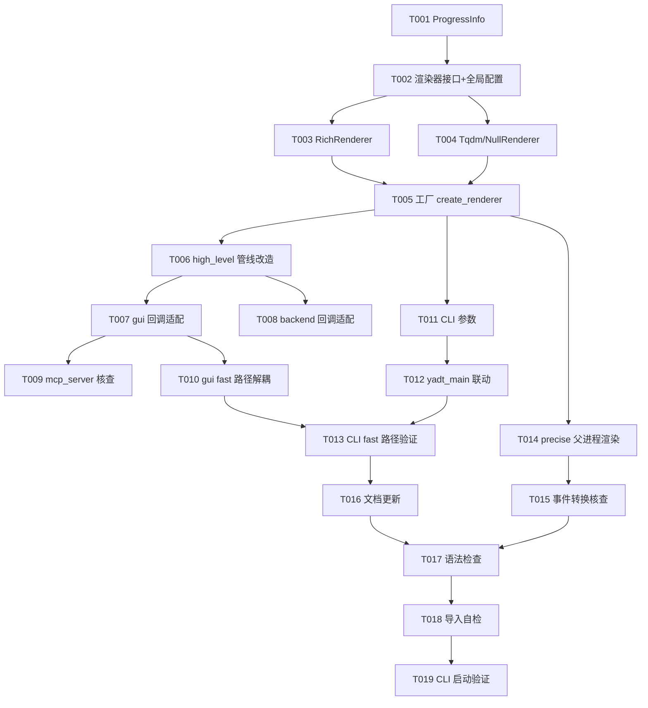

# Tasks: 翻译进度条彩色化（pip 风格 rich 进度条）

**Input**: Design documents from `spec/rich-progress-bar/`

**Prerequisites**: plan.md（必需）、spec.md（必需，用户故事）

## Format: `[ID] [P?] [Story] Description`

- **[P]**: 可并行（不同文件、无依赖）
- **[Story]**: 所属用户故事（US1/US2/US3）
- 路径均为仓库内相对路径

## Path Conventions

- 单项目仓库：源码位于 `pdf2zh/`（包根），kernel 子包位于 `pdf2zh/kernel/`
- 规格/设计/任务文档：`spec/rich-progress-bar/`
- 本特性不新增目录，仅新增 `pdf2zh/progress.py` 单模块

---

## Phase 1: Setup（共享基础设施）

**Purpose**: 进度模块地基 — 所有用户故事的唯一依赖

- [x] T001 创建 `pdf2zh/progress.py`：定义 `ProgressInfo` 数据类（字段 stage/current/total/overall/message，见 plan.md Data Model）
- [x] T002 在 `pdf2zh/progress.py` 实现渲染器接口（start/update/finish/close + 上下文管理器 Protocol）与全局样式配置（默认 rich；导入时读取环境变量 `PDF2ZH_PROGRESS=rich|plain`；提供模块级样式设置函数供 CLI 覆盖）

**Checkpoint**: 进度模块数据模型与接口就绪

---

## Phase 2: Foundational（阻塞性前置）

**Purpose**: 渲染器实现 — 三个用户故事共用的渲染能力

- [x] T003 在 `pdf2zh/progress.py` 实现 `RichRenderer`：rich Progress（TextColumn 描述 + BarColumn 彩条 + MofNCompleteColumn + TimeElapsedColumn + TimeRemainingColumn，列组合对齐 babeldoc 内置 rich 模式），支持注入共享 Console
- [x] T004 [P] 在 `pdf2zh/progress.py` 实现 `TqdmRenderer`（纯色回退，包装 tqdm，行为对齐现状）与 `NullRenderer`（无输出）
- [x] T005 在 `pdf2zh/progress.py` 实现工厂 `create_renderer()`：按全局样式 + 环境降级规则（`NO_COLOR`、stdout 非 TTY 重定向）选择渲染器实例

**Checkpoint**: 渲染器族就绪，用户故事可开始

---

## Phase 3: User Story 1 - GUI 模式控制台彩色进度条 (Priority: P1) 🎯 MVP

**Goal**: GUI（`pdf2zh -i`）翻译时终端显示 rich 彩色进度条，网页端进度零回归

**Independent Test**: 启动 GUI，翻译一份多页 PDF，终端出现 rich 彩条，网页进度推进至 100%

- [x] T006 [US1] 改造 `pdf2zh/high_level.py` 的 `translate_patch`：将三处 tqdm（约 150 行页面主循环、248 行段落翻译、262 行排版）替换为 `create_renderer()` 创建的渲染器；三处 `callback(progress)` 调用点改为构造 `ProgressInfo`（阶段/当前值/总值/总体进度/描述）后调用 `callback(info)`；overall 跨阶段单调不减（实现期定义阶段换算权重）
- [x] T007 [US1] 改造 `pdf2zh/gui.py` 的 `progress_bar`（约 599 行）：回调签名改为消费 `ProgressInfo` → `gradio progress(info.overall, desc=info.message)`；移除对 tqdm 属性的直接访问
- [x] T008 [P] [US1] 改造 `pdf2zh/backend.py` 的 `progress_bar`（约 45 行）：消费 `ProgressInfo` → `update_state(meta={"n": info.current, "total": info.total})`，celery 上报语义不变
- [x] T009 [US1] 核查 `pdf2zh/mcp_server.py` 是否存在 callback 消费点，如有一并适配 `ProgressInfo`
- [x] T010 [US1] 改造 `pdf2zh/gui.py` 的 fast 路径（gui.py 中 babeldoc/fast 相关配置，原 use_rich_pbar=False 处约 749 行）：终端渲染统一由管线渲染器负责，网页进度由归一化回调负责，移除强制关闭彩色渲染的配置

**Checkpoint**: GUI fast 场景端到端可用（终端彩色 + 网页进度正常）

---

## Phase 4: User Story 2 - CLI fast 模式彩色进度条 + 回退开关 (Priority: P2)

**Goal**: 命令行 `pdf2zh 文档.pdf`（fast 默认模式）终端 rich 彩色条，`--progress-style plain` 回退纯色

**Independent Test**: CLI 翻译一份 PDF 终端出现彩条；加 `--progress-style plain` 回退纯色 tqdm

- [x] T011 [US2] 在 `pdf2zh/pdf2zh.py` 的 `create_parser` 增加 `--progress-style {rich,plain}` 参数（默认 rich，加入现有 CLI 帮助）；`parse_args`/`main` 解析后调用 progress 模块的全局样式设置函数
- [x] T012 [US2] 在 `pdf2zh/pdf2zh.py` 的 `yadt_main`（约 583 行 YadtConfig 构造处）：`use_rich_pbar` 联动全局样式（rich→True，plain→False），保持 `--babeldoc` 实验路径彩色渲染
- [x] T013 [US2] 验证 CLI fast 路径（main → LegacyKernel → high_level.translate）继承 T006 的渲染器改造后行为正确：默认 rich、`--progress-style plain` 时 TqdmRenderer、`PDF2ZH_PROGRESS` 环境变量覆盖生效

**Checkpoint**: CLI fast 场景彩色 + 开关可用

---

## Phase 5: User Story 3 - CLI precise 模式彩色进度条 (Priority: P3)

**Goal**: `pdf2zh --mode precise 文档.pdf` 终端 rich 彩色条（父进程渲染）

**Independent Test**: precise 模式翻译一份 PDF，终端出现彩条，产物正常生成

- [x] T014 [US3] 改造 `pdf2zh/kernel/precise.py` 的 `translate` 与 `translate_async`：父进程消费 v2_worker 转发的进度事件 JSON（progress_start/progress_update/progress_end），转换为 `ProgressInfo` 后 a) 喂给 `create_renderer()` 渲染器（终端彩色）b) 调用 `callback(info)`；非进度 stderr 日志行维持原样打印；渲染器生命周期与子进程一致（启动开、结束收尾）
- [x] T015 [US3] 核查 `pdf2zh/kernel/v2_worker.py` 事件转发字段（stage/stage_current/stage_total/overall_progress）与 `ProgressInfo` 转换的完整性，不丢失 overall_progress

**Checkpoint**: precise 场景父进程彩色渲染可用

---

## Phase 6: Polish（横切收尾）

**Purpose**: 文档与一致性

- [x] T016 [P] 更新 `README.md` 与 `README.en.md`：在 CLI 参数说明处补充 `--progress-style`（与现有 CLI 文档风格一致）；如 README 无 CLI 参数清单则仅在合适位置提及彩色进度条与回退开关

---

## Phase 7: Verification

<!-- verification_scope: build-only -->

**Purpose**: 运行验证 — 语法/导入/启动自检（无真实翻译验证）

- [x] T017 全量语法检查：对改动的 7 个文件（`pdf2zh/progress.py`、`pdf2zh/high_level.py`、`pdf2zh/pdf2zh.py`、`pdf2zh/gui.py`、`pdf2zh/backend.py`、`pdf2zh/mcp_server.py`、`pdf2zh/kernel/precise.py`）执行 Python 编译检查并修复全部错误
- [x] T018 导入自检：在项目环境内导入 `pdf2zh.progress` 并实例化三类渲染器与 `ProgressInfo`，确认 `create_renderer()` 在默认环境返回 RichRenderer；`pdf2zh.gui`、`pdf2zh.high_level`、`pdf2zh.pdf2zh` 可正常导入（无循环导入）
- [x] T019 CLI 启动验证：`pdf2zh --help` 显示 `--progress-style` 参数且无报错；GUI 入口 `python -c "import pdf2zh.gui"` 无异常

---

## Dependencies & Execution Order

### 依赖图



### 并行执行指南

| Phase | 可并行任务 | 涉及文件 | 说明 |
|---|---|---|---|
| Phase 2 | T003 与 T004 | pdf2zh/progress.py（同文件顺序执行更稳） | T004 标 [P] 但同文件，建议串行 |
| Phase 3 | T008 与 T006/T007 | backend.py 独立于 high_level/gui | T008 可先行 |
| Phase 5 | T014 独立于 Phase 3/4 其余任务 | kernel/precise.py | 仅依赖 Phase 2 |
| Phase 6 | T016 | README.md / README.en.md | 文件独立 |

### 用户故事依赖

- **US1（P1）**: 依赖 Phase 2 完成；无跨故事依赖
- **US2（P2）**: 依赖 Phase 2 完成；T013 依赖 T006/T010 的管线改造落地
- **US3（P3）**: 仅依赖 Phase 2；与 US1/US2 无文件冲突（kernel/precise.py 独立）

---

## Parallel Example: User Story 1

```bash
# T008（backend.py）可与 T006（high_level.py）/T007（gui.py）并行：
Task: "T008 [P] [US1] backend.py progress_bar 消费 ProgressInfo"
Task: "T006 [US1] high_level.py translate_patch 渲染器化"

# Phase 2 完成后 US3 的 T014 可与 US1/US2 并行：
Task: "T014 [US3] kernel/precise.py 父进程渲染"
Task: "T011 [US2] pdf2zh.py CLI 参数"
```

---

## Implementation Strategy

### MVP First（仅 US1）

1. 完成 Phase 1–2（进度模块 + 渲染器族）
2. 完成 Phase 3（T006–T010）：GUI 场景端到端
3. **停下验证**：GUI 翻译观察终端彩条 + 网页进度
4. 交付 MVP

### Incremental Delivery

1. Setup + Foundational → 渲染地基
2. +US1（GUI）→ MVP 交付（用户主痛点）
3. +US2（CLI fast + 开关）→ 三场景之二，开关可用
4. +US3（precise）→ 全场景覆盖
5. +Polish（文档）→ 收尾

---

## Notes

- 渲染器必须通过上下文管理器保证异常/取消路径下正确收尾（终端光标复位、无 ANSI 残留）
- `high_level.py` 的 `translate` 签名（`callback: object = None`）不变，仅回调收到的对象类型从 tqdm 实例变为 ProgressInfo
- 禁止改动 `pdf2zh/kernel/v2_worker.py` 的事件协议（子进程边界，跨 venv 兼容）
- CI 冒烟判据（GUI 启动 + 7860 端口 + "find offline_assets_zip" 日志）不得受影响
- 提交风格：conventional commits（如 `feat(ui): ...`）
